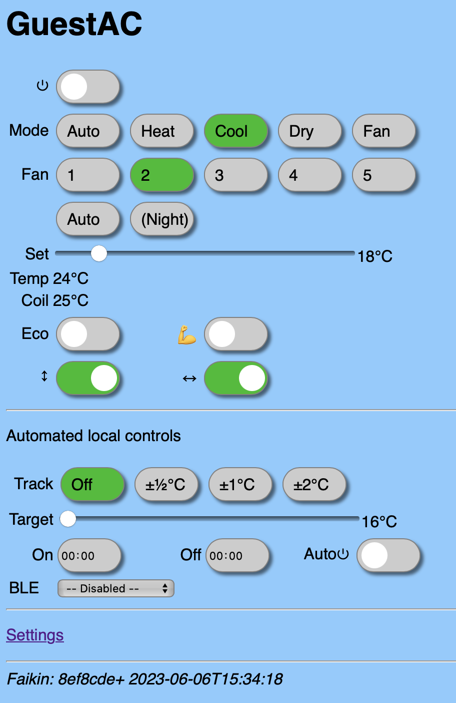

# Web controls

Open the web controls with the hostname you set. This page uses `GuestAC` as the example, so the address is `GuestAC.local`.

Example

## Main operation

The first section has the direct controls and the status of the aircon. The controls shown depend on the unit and on the settings.

A change takes effect at once. Changes made elsewhere, for example with the IR remote, show up within seconds.

## Heating control

The heating control section has:

- **Heating control**: turns Säädin's heating controller on or off.
- **Target**: the room temperature to keep, in 0.1 °C steps.
- **A status line**: what the controller is doing, for example "Demand 60% QO · target 21.3 · heat 350 W".

The controller works only when the unit is on in heat mode. It does not turn the unit on or off. While it runs, *Set*, *Demand* and *Quiet outdoor* in the main section are greyed out, because the controller sets them. *Set* shows 30 °C most of the time, which is expected.

See [Heating control](Heating.md) for how it works and for its settings.

## BLE

The heating control needs a room temperature reading, which the unit's own sensor does not give. If BLE is on, choose a BlueCoinT, Telink or GoveeLife sensor here, ideally one placed where you sit or sleep. Without a BLE sensor, send the room temperature over MQTT instead (see [Heating control](Heating.md#room-temperature-over-mqtt)).

For more about sensors, see [BLE sensors](BLE.md).
